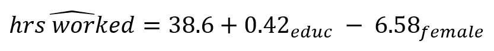

```{r echo=FALSE}

#| label: setup
#| message: false
#| include: false

## Load packages, custom functions, and styles
source("custom-setup-styles.R")

knitr::opts_knit$set(digits = 2)

# Set global theme with base font size 20
theme_set(theme_minimal(base_size = 20))

# Override default discrete color and fill scales
scale_colour_discrete <- function(...) scale_color_manual(values = my_palette)

# Color in math equations
# https://egallic.fr/Recherche/aide-memoire/quarto_equation_colors.html#colors-in-equations-with-revealjs
```

# Agenda {data-menu-title="Agenda" background-image="images/calendar.png" background-size="100px" background-repeat="repeat"}

-   Two continuous variables
-   One continuous & one categorical variable

::: notes

:::

# Learning objectives

By the end of the lecture, you will be able to ...

-   Use R to produce multivariate regression  
-   Use R to create publication ready regression tables (e.g., Table 02)  
-   Use R to produce $R^2$ and interpret it

# Code-along 07 {data-menu-title="Code-along" background-image="images/terminal.png"}

Download and open [code-along-07.qmd](https://www.dropbox.com/scl/fi/v8424d20a8rogis1fdk0l/code-along-07.qmd?rlkey=t8x0w3uhe5za9yxwobncspv2b&st=re6nff2o&dl=1)

## Packages {.sparse-slide}

Load the standard packages and new package `modelbased`.

```{r}
#| message: false
#| label: load

# install.packages("marginaleffects") # needed for modelbased
# install.packages("modelbased")

library(tidyverse) 
library(haven) # not core tidyverse
library(gssr)
library(gssrdoc)
library(summarytools)
library(gtsummary) 
library(modelbased)

# do not load moderndive(), use it specifically 

```

## Load your data {.sparse-slide}

```{r}
#| message: false
#| label: gssdata

# Load all gss
data(gss_all)

```

## Variables {.sparse-slide .smaller}

-   `year` Survey year
-   `tvhours` Hours per day watching tv
-   `realrinc` R's income in constant $
-   `age` Age of respondent
-   `educ` Respondents highest edu credit
-   `hrs1` How many hours did you work last week
-   `childs` How many children have you ever had?
-   `polviews` Think of self as liberal or conservative
-   `sex` Respondents sex
-   `marital` R's marital status

## {data-menu-title="Variable Management" .smaller}

::: task
 Make a df with only the (pretty) categorical and continuous
variables we'll analyze.
:::


```{r}
#| message: false
#| label: my-data

# Categorical Variables
my_cat <- gss_all |>
  select(id, year, polviews, sex, marital) |>
  zap_missing() |>
  mutate(
    polviews = as_factor(polviews),
    sex = as_factor(sex),
    marital = as_factor(marital)) |> 
  droplevels()

# Continuous Variables
my_con <- gss_all |>
  select(id, year, tvhours, age, educ, hrs1, realrinc, childs) |>
  mutate(
    age = as.numeric(age),
    educ = as.numeric(educ),
    hrs1 = as.numeric(hrs1),
    realrinc = as.numeric(realrinc),
    childs = as.numeric(childs))

# Combine the two dataframes
my_data <- full_join(my_cat, my_con, by = c("year", "id")) # match by 2 vars

```


# Two continuous variables {.theme-section}

##  {data-menu-title="Code Meets Question" .sparse-slide background-image="images/gears-solid-full.png" background-size="80px" background-repeat="repeat"}

::: task
 Have the average number of children changed over time?
:::

. . .

```{r, echo = FALSE}
#| label: plot-01

# Create scatterplot with a regression line
my_data |>
  group_by(year) |>
  summarize(avg = mean(childs, na.rm = TRUE)) |>
  ggplot(aes(x = year, y = avg)) +
  geom_point(color = "#18BC9C", size = 3) +
  geom_smooth(method = "lm", se = FALSE, color = "#3498DB") +
  labs(
    title = "Scatterplot of Average Number of Children",
    x = "Year",
    y = "Average number of children") +
  theme_minimal(20)
```

::: notes
assumed to be a count, but can be modeled with OLS if treated as continuous
:::


## Simple Regression {.sparse-slide}

```{r}
#| label: regress-01
#| output-location: fragment

model_01 <- lm(formula = childs ~ year, data = my_data)
moderndive::get_regression_table(model_01) 
```

::: notes

:::

## Proportional Reduction of Error {.sparse-slide}

The better a least-squares line is, the better it can predict an outcome with the least amount of error

<br>

$r^2$ is a **p**roportional **r**eduction of **e**rror (PRE) measure

<br>

$PRE = \frac{E1 - E2}{E1}$

<br>

It tells us how well the regression model fits the data  

## {data-menu-title="PRE Equation" .sparse-slide .smaller}

$R^2 = \frac{\sum E1^2 - \sum E2^2}{\sum E1^2}$

<br>

:::: {.columns .smaller}

::: {.column}

**E1**  
Errors of prediction made when IV is ignored  

<br>

Equivalent to the sum of errors we would have if we guessed that every Y was equal to the mean of Y  

<br>


[aka Sum of Squares Total (SST)]{style="color: #3498db; font-family: 'Shadows Into Light'"}  
:::

::: {.column}
**E2**  
Errors of prediction made based on IV  

<br>

Equivalent to the sum of errors we would have if we used our least squares line to predict Y  

<br>

[aka Sum of Squared Errors (SSE)]{style="color: #3498db; font-family: 'Shadows Into Light'"}    
:::

::::


## {data-menu-title="`get_regression_points()`" .sparse-slide}

::: task
 Use `get_regression_points()` to see E2.
:::

<br>

. . .

```{r}
#| label: get_regression_points
#| message: false
#| output-location: fragment

model_01 <- lm(formula = childs ~ year, data = my_data)

moderndive::get_regression_points(model_01) |>
  dplyr::slice_sample(n = 5)  |>  # preview a random sample
  select(ID, year, childs, childs_hat, residual)

```

## See E1 & E2 {.sparse-slide}

```{r}
#| label: get_errors
#| message: false
#| output-location: fragment

moderndive::get_regression_points(model_01) |>
  dplyr::mutate(
    mean_pred = mean(childs),
    E1 = (childs - mean_pred),
    E2 = residual) |>
  dplyr::slice_sample(n = 5) |>
  select(ID, year, childs,  mean_pred, childs_hat, E1, E2)

```

## {data-menu-title="$R^2$ interpretation" .sparse-slide}  

$R^2$ ranges from 0 to 1.0

<br>

**1.0** = Our independent variable accounts for all the variation that we find in the dependent variable (it predicts the dependent variable perfectly).  

<br>

**0.0** = Our independent variable does not improve our ability to predict the dependent variable.

<br>

[In the social sciences, a high $R^2$ is rare!]{style="color: #3498db; font-size: 100%; font-family: 'Shadows Into Light'"}


## $R^2$ calculation {.sparse-slide }

```{r}
#| label: r-squared-01
#| message: false

my_test <- cor.test(
     ~ childs + year,
     data = my_data,
     method = "pearson",
     na.action = na.omit
 ) 

```
  
. . .

R  
```{r}
#| label: r-squared-02
#| message: false

round(my_test$estimate, 3)

```
  
. . .

$R^2$  
```{r}
#| label: r-squared-03
#| message: false

round((my_test$estimate)^2, 3)

```

## {data-menu-title="`get_regression_summaries()`" .sparse-slide}  

::: task
 Use `get_regression_summaries()` to see $R^2$.
:::

<br>

. . .

```{r}
#| label: get-regression-summ

model_01 <- lm(formula = childs ~ year, data = my_data)

moderndive::get_regression_summaries(model_01)
```

<br> 

::: {style="color: #18BC9C; font-size: 70%; font-family: 'Shadows Into Light'"}
$R^2$ shows the amount of variance of the DV explained by the IV(s).
:::

## $R^2$ interpretation {.sparse-slide}

An $R^2$ of $0.005$ means that knowing the survey year reduces our error in predicting average number of children by [**.5%**]{style="color: #18bc9c"} compared with not using survey year at all.  

<br>

The survey year explains [**.5%**]{style="color: #18bc9c"} of variation in average number of children.


::: notes
The slope could be strongly negative and highly significant, indicating a clear decline in fertility over time. But if there is still a lot of variation around that trend, the R^2 can remain quite small.
:::


##  {data-menu-title="Code Meets Question" .sparse-slide background-image="images/gears-solid-full.png" background-size="80px" background-repeat="repeat"}

::: task
 Are the trends explained by increases in education?
:::

```{r, echo = FALSE}
#| label: plot-02

# Create scatterplot with regression line
my_data |>
  group_by(year) |>
  summarize(avg = mean(educ, na.rm = TRUE)) |>
  ggplot(aes(x = year, y = avg)) +
  geom_point(color = "#18BC9C", size = 3) +
  geom_smooth(method = "lm", se = FALSE, color = "#3498DB") +
  labs(
    title = "Scatterplot of Average Years of Education",
    x = "Year",
    y = "Average years of education"
  ) +
  theme_minimal(20)
```

##  {data-menu-title="Scatterplot: Number of children & education"}

```{r, echo = FALSE}
#| label: plot-03

# Create scatterplot with regression line
my_data |>
  group_by(educ) |>
  summarize(avg = mean(childs, na.rm = TRUE)) |>
  ggplot(aes(x = educ, y = avg)) +
  geom_point(color = "#18BC9C", size = 3) +
  geom_smooth(method = "lm", se = FALSE, color = "#3498DB") +
  labs(
    title = "Scatterplot of Average Number of Children",
    x = "Average years of education",
    y = "Average number of children"
  ) +
  theme_minimal(20)
```


##  {data-menu-title="Multiple Regression" .sparse-slide}

```{r}
#| label: regress-01-review

model_01 <- lm(formula = childs ~ year, data = my_data)
moderndive::get_regression_table(model_01)

```

<br>

. . . 

```{r}
#| label: regress-02
#| output-location: fragment

model_02 <- lm(formula = childs ~ year + educ, data = my_data)
moderndive::get_regression_table(model_02)

```

::: notes
[Holding survey year constant]/[After accounting for survey year], a one-year increase in average years of education is associated with a 0.131 decrease in the average number of children, on average.  
  
The model predicts an average of 5.26 children for a population with 0 years of education in year 0. (mathematical starting point)  
:::


## Change in PRE Measure {.sparse-slide} 

```{r}
#| label: summaries-01-review

moderndive::get_regression_summaries(model_01)

```

<br>

. . .

```{r}
#| label: summaries-02

moderndive::get_regression_summaries(model_02)

```


::: notes
Did the R^2 improve?  
:::

## `tbl_regression()` {.sparse-slide}

OLS Regression predicting number of children by survey year and years of education

```{r}
#| label: tbl_regression
#| output-location: fragment

model_02 |>
  tbl_regression(intercept = TRUE)  

```

::: notes
model_02 |>
  tbl_regression(intercept = TRUE, estimate_fun = ~ style_number(.x, digits = 4))  
:::


## `tbl_regression()` {.sparse-slide}

OLS Regression predicting number of children by survey year and years of education

```{r}
#| label: tbl_regression-partial
#| output-location: fragment
#| code-line-numbers: "4-5"

model_02 |>
  tbl_regression(
    intercept = TRUE) |>
  modify_column_hide(conf.low) |>
  modify_column_unhide(column = std.error) 

```

## `tbl_regression()` {.sparse-slide}

::: {.smaller}
OLS Regression predicting number of children by survey year and years of education
:::

```{r}
#| label: tbl_regression-full
#| output-location: fragment
#| code-line-numbers: "6-8"

model_02 |>
  tbl_regression(
    intercept = TRUE) |>
  modify_column_hide(conf.low) |>
  modify_column_unhide(column = std.error) |>
  remove_abbreviation() |>
  add_significance_stars() |>
  add_glance_table(include = c("r.squared", "nobs"))

```


# 1 continuous variable & 1 categorical variable  {.theme-section}

##  {data-menu-title="Code Meets Question" .sparse-slide background-image="images/gears-solid-full.png" background-size="80px" background-repeat="repeat"}

::: task
 Are weekly hours worked related to education and gender?
:::

<br>

. . .

```{r}
#| label: regress-03
#| output-location: fragment

model <- lm(hrs1 ~ educ + sex, data = my_data)

moderndive::get_regression_table(model)
```

. . .  

{fig-align="center" width="50%"}


## `tbl_regression()` {.sparse-slide}

OLS Regression predicting weekly work hours by years of education and gender

```{r}
#| label: regress-03-table
#| output-location: column-fragment

model |>
  tbl_regression(
    intercept = TRUE) |>
  modify_column_hide(conf.low) |>
  modify_column_unhide(
    column = std.error) |>
  remove_abbreviation() |>
  add_significance_stars() |>
  add_glance_table(
    include = c("r.squared", "nobs"))

```

## `tbl_regression()` {.sparse-slide}

OLS Regression predicting weekly work hours by years of education and gender

```{r}
#| label: dichotomous
#| output-location: column-fragment
#| code-line-numbers: "2-5"

model |>
  tbl_regression(
    intercept = TRUE,
    show_single_row = sex,
    label = list(sex = "Women")) |>
  modify_column_hide(conf.low) |>
  modify_column_unhide(
    column = std.error) |>
  remove_abbreviation() |>
  add_significance_stars() |>
  add_glance_table(
    include = c("r.squared", "nobs"))

```


##  {data-menu-title="Code Meets Question" .sparse-slide background-image="images/gears-solid-full.png" background-size="80px" background-repeat="repeat"}

::: task
 Are weekly hours worked related to education and marital status?
:::

<br>

. . .

```{r}
#| label: regress-04
#| output-location: fragment

model <- lm(hrs1 ~ educ + marital, data = my_data)
moderndive::get_regression_table(model)

```


## { data-menu-title="`tbl_regression()`" .sparse-slide}

Regression Predicting Weekly Work Hours by Years of Education and Marital Status

```{r}
#| label: reference
#| output-location: column-fragment
#| code-line-numbers: "2-6"

model |>
  tbl_regression(
    intercept = TRUE,
    label = list(
      marital = "Marital status (ref. = married)")) |>
  remove_row_type(type = c("reference")) |>  
  modify_column_hide(conf.low) |>
  modify_column_unhide(
    column = std.error) |>
  remove_abbreviation() |>
  add_significance_stars() |>
  add_glance_table(
    include = c("r.squared", "nobs"))

```

##  {data-menu-title="Code Meets Question" .sparse-slide background-image="images/gears-solid-full.png" background-size="80px" background-repeat="repeat"}

::: task
 Are daily TV hours related to education and political identity?
:::

<br>

. . .

```{r}
#| label: regress-05
#| output-location: slide

my_data <- my_data |>
  mutate(pol_group = case_when(
    polviews %in% c("extremely liberal", "liberal", "slightly liberal") ~ "Liberal",
    polviews == "moderate, middle of the road" ~ "Moderate",
    polviews %in% c("slightly conservative", "conservative", "extremely conservative") ~ "Conservative",
    TRUE ~ NA_character_))

model <- lm(tvhours ~ educ + pol_group, data = my_data)

moderndive::get_regression_table(model)
```

## Change reference level {.sparse-slide}

```{r}
#| label: relevel
#| output-location: fragment

# Change to factor and change order
my_data$pol_group <- factor(
  my_data$pol_group,
  levels = c("Moderate", "Liberal", "Conservative"))

# OR ....

# change to factor and explicitly state reference category
my_data$pol_group <- relevel(factor(my_data$pol_group), 
                            ref = "Moderate")

table(my_data$pol_group)

```

## Change reference level {.sparse-slide}

```{r}
#| label: model-relevel
#| output-location: fragment

model <- lm(tvhours ~ educ + pol_group, data = my_data)
moderndive::get_regression_table(model)
```
  
## Change reference level {.sparse-slide}

```{r}
#| label: model-relevel-2
#| eval: false

model <- lm(tvhours ~ educ + relevel(pol_group, ref = "Liberal"), data = my_data)
moderndive::get_regression_table(model) 
```

<br>  
  
::: {style="font-size: 50%"}
  
```{r}
#| label: model-relevel-2-kable
#| echo: false

model <- lm(tvhours ~ educ + relevel(pol_group, ref = "Liberal"), data = my_data)
moderndive::get_regression_table(model) |>
  kable()
```

:::

# Think Like a Statistician {.sparse-slide background-image="images/lightbulb-solid.png" background-size="80px" background-repeat="repeat"}

## Think Like a Statistician {background-image="images/lightbulb-solid.png" background-size="80px" background-repeat="repeat" .sparse-slide}

::: task
 1. Run and interpret a regression predicting `realrinc` with `hrs1` and `educ`
:::

<br>

. . .

```{r}
model <- lm(realrinc ~ hrs1 + educ, data = my_data)
moderndive::get_regression_table(model)
```

## Think Like a Statistician {background-image="images/lightbulb-solid.png" background-size="80px" background-repeat="repeat" .sparse-slide}

::: task
 2. Add `childs` to the regression. Interpret the output.
::: 

<br>

. . .

```{r}
model <- lm(formula = realrinc ~ hrs1 + educ + childs, data = my_data)
moderndive::get_regression_table(model)
```

## Think Like a Statistician {background-image="images/lightbulb-solid.png" background-size="80px" background-repeat="repeat" .sparse-slide .smaller}

::: task
 3. Add `marital` to the regression. Interpret the output.
::: 

<br>

. . .

```{r}
model <- lm(formula = realrinc ~ hrs1 + educ + childs + marital, data = my_data)
moderndive::get_regression_table(model)
```
