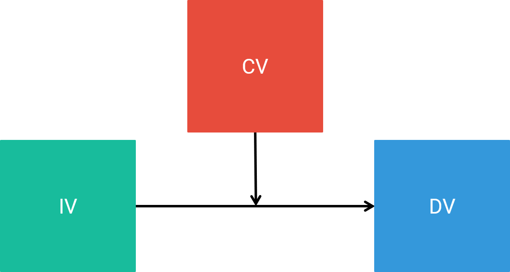

```{r echo=FALSE}

#| label: setup
#| message: false
#| include: false

## Load packages, custom functions, and styles
source("custom-setup-styles.R")

knitr::opts_knit$set(digits = 2)

# Set global theme with base font size 20
theme_set(theme_minimal(base_size = 20))

# Override default discrete color and fill scales
scale_colour_discrete <- function(...) scale_color_manual(values = my_palette)

# Color in math equations
# https://egallic.fr/Recherche/aide-memoire/quarto_equation_colors.html#colors-in-equations-with-revealjs
```

# Agenda {data-menu-title="Agenda" background-image="images/calendar.png" background-size="100px" background-repeat="repeat"}

- Predictions
- Interactions

::: notes
:::

# Learning objectives

By the end of the lecture, you will be able to ...

-   Generate and communicate predictions from OLS regression models.
-   Estimate, visualize, and communicate interaction effects in OLS regression models.

# Code-along 08 {data-menu-title="Code-along" background-image="images/terminal.png"}

Download and open [code-along-08.qmd]()

## Packages {.sparse-slide}

Load the standard packages and new package `modelbased`.

```{r}
#| message: false
#| label: load

# install.packages("marginaleffects") # needed for modelbased
# install.packages("modelbased")

library(tidyverse) 
library(haven) # not core tidyverse
library(gssr)
library(gssrdoc)
library(summarytools)
library(gtsummary) 
library(modelbased)

# do not load moderndive(), use it specifically 

```

## Load your data {.sparse-slide}

```{r}
#| message: false
#| label: gssdata

# Load all gss
gss24 <- gss_get_yr(2024)

```

## Variables {.sparse-slide .smaller}

- `realrinc` R's income in constant \$
- `age` Age of respondent
- `educ` Respondents highest edu credit
- `hrs1` How many hours did you work last week
- `sex` Respondents sex
- `marital` R's marital status

##  {.smaller data-menu-title="Variable Management"}

::: task
 Make a df with only the (pretty) categorical and
continuous variables we'll analyze.
:::

```{r}
#| message: false
#| label: my-data

# Categorical Variables
my_cat <- gss24 |>
  select(id, sex, marital) |>
  zap_missing() |>
  mutate(
    sex = as_factor(sex),
    marital = as_factor(marital)) |> 
  droplevels()

# Continuous Variables
my_con <- gss24 |>
  select(id, age, educ, hrs1, realrinc) |>
  mutate(
    age = as.numeric(age),
    educ = as.numeric(educ),
    hrs1 = as.numeric(hrs1),
    realrinc = as.numeric(realrinc))

# Combine the two dataframes
my_data <- full_join(my_cat, my_con, by = c("id")) |> 
  drop_na() |>
  mutate(
    marital = recode(
      marital,
      "married"       = "Married",
      "never married" = "Never married",
      "widowed"       = "Div/Wid/Sep",
      "divorced"      = "Div/Wid/Sep",
      "separated"     = "Div/Wid/Sep"),
    marital = factor(
      marital,
      levels = c("Never married", "Div/Wid/Sep", "Married"))
  )
```

# Predictions {.theme-section}

## {data-menu-title="Regression Model"}

OLS Regression Predicting Annual Income

```{r}
#| label: regress
#| echo: false

model <- lm(formula = realrinc ~ educ + hrs1 + sex + marital, data = my_data)

model |>
    tbl_regression(
    intercept = TRUE,
        show_single_row = sex,
    label = list(
      sex = "Women",
      marital = "Marital status (ref. = never married)")) |>
  remove_row_type(type = c("reference")) |>  
  modify_column_hide(conf.low) |>
  modify_column_unhide(
    column = std.error) |>
  remove_abbreviation() |>
  add_significance_stars() |>
  add_glance_table(
    include = c("r.squared", "nobs"))

```

## Typical-person predictions {.smaller .sparse-slide}

[**What does "holding other variables constant"
mean?**]{style="color: #3498db; font-size: 125%; font-family: 'Shadows Into Light'"}

<br>

For a prediction at the means, we set:

- continuous variables to their means\
- categorical variables to their reference categories

::::: columns
::: {.column width="50%"}
```{r}
#| label: means

mean(my_data$educ)
mean(my_data$hrs1)

```
:::

::: {.column width="50%"}
Education = 14.78\
Hours worked = 39.79\
Sex = Male (reference)\
Marital status = Married (reference)
:::
:::::

## Typical-person predictions {.sparse-slide}

```{r}
#| label: typical

estimate_means(
  model,
  estimate = "typical")
```

## Typical-person predictions {.smaller .sparse-slide}

Typical never-married man  
$\color{#18bc9c}{-34,540} \color{#3498db}{+2,845}_{educ}*14.8$
$\color{#fd7e14}{+424}_{hrs1}*39.56$

<br>

[Typical never married woman  
$\color{#18bc9c}{-34,540} \color{#3498db}{+2,845}_{educ}*14.8$
$\color{#fd7e14}{+424}_{hrs1}*39.56$
$\color{#e74c3c}{-6,544}_{female}$]{.fragment}

<br>

[Typical married man  
$\color{#18bc9c}{-34,540} \color{#3498db}{+2,845}_{educ}*14.8$
$\color{#fd7e14}{+424}_{hrs1}*39.56$
$\color{#9b59b6}{+11,182}_{married}$]{.fragment}

<br>

[Typical divorced woman  
$\color{#18bc9c}{-34,540} \color{#3498db}{+2,845}_{educ}*14.8$
$\color{#fd7e14}{+424}_{hrs1}*39.56$
$\color{#e74c3c}{-6,544}_{female}$
$\color{#9b59b6}{+5,512}_{divorced}$]{.fragment}

##  {.sparse-slide data-menu-title="Typical-person predictions"}

```{r}
#| label: typical-ggplot
#| echo: false

preds <- estimate_means(
  model,
  estimate = "typical")

ggplot(
  preds,
  aes(x = marital, y = Mean, color = sex)) +
  geom_point(size = 3,
             position = position_dodge(width = .4)) +
  geom_errorbar(
    aes(ymin = CI_low, ymax = CI_high),
    width = .1,
    position = position_dodge(width = .4)) +
  labs(
    title = "Predicted Income for Typical People",
    subtitle = "Hours worked and education fixed at their means",
    x = "Marital Status",
    y = "Predicted Income",
    color = "Gender") +
  theme_minimal(20)
```

## Marginal Means {.sparse-slide .smaller}

**Marginal means are adjusted group averages**.\
Calculated from the regression model while accounting for the
distribution of the other predictors in the data.

<br>

```{r}
#| label: typical-sex

marginal_means <- estimate_means(
  model,
  by = "sex",
  estimate = "typical")

marginal_means
```

## Average Adjusted Predictions (AAP) {.sparse-slide .smaller}

**Average adjusted predictions are adjusted population averages.**\
Calculated from the regression model using the actual characteristics of
individuals in the dataset.

```{r}
#| label: aap-sex

aap <- estimate_means(
  model,
  by = "sex",
  estimate = "average")

aap

```

::: notes
Unlike a typical-person prediction, AAPs do not create a hypothetical
"average" person. Instead, predictions are generated using the observed
characteristics of individuals in the dataset and then averaged.
:::

##  {.smaller .sparse-slide data-menu-title="Marginal Means & AAP"}

```{r}
#| label: compare
#| echo: false

marginal_means$method <- "Marginal Means"
aap$method <- "AAP"

bind_rows(marginal_means, aap) |>
  ggplot(
    aes(x = sex, y = Mean,
        color = method,
        group = method)) +
  geom_point(size = 4,
             position = position_dodge(width = .4)) +
  geom_errorbar(
    aes(ymin = CI_low, ymax = CI_high),
    position = position_dodge(width = .4),
    width = .1) +
  labs(
    title = "Marginal Means vs. Average Adjusted Predictions",
    subtitle = "Predicted income for men and women",
    x = NULL,
    y = "Predicted Income",
    color = "Method"
  ) +
  theme_minimal(base_size = 20)
```

## Three Types of Predictions {.sparse-slide}

**Typical-person prediction**\
Prediction for a hypothetical person with average values.

<br>

**Marginal mean** Adjusted average prediction for a group.

<br>

**Average adjusted prediction (AAP)** Adjusted average prediction
calculated using the actual characteristics of people in the data.

# Interactions {.theme-section}

##  {.sparse-slide data-menu-title="Interactions"}

Interactions test a conditional relationship



## Interactions {.sparse-slide .smaller}

Without an interaction, the effect of $X_1$ on Y is $b_1$

$$
\hat{Y} = b_0 + b_1X_1 + b_2X_2
$$

. . .

<br>

With an interaction, the effect of $X_1$ on Y changes as $X_2$ changes\
Effect of $X_1$ on Y depends on the level of $X_2$

$$
\hat{Y} = b_0 + b_1X_1 + b_2X_2 + \color{#18bc9c}{b_3(X_1X_2)}
$$

## Categorical X Continuous {.sparse-slide background-image="images/gears-solid-full.png" background-size="80px" background-repeat="repeat"}

::: task
 Does marital status modify the relationship between education and income?
:::

```{r}
#| label: mod01-1
#| output-location: slide

model_01 <- lm(formula = realrinc ~ educ + marital + age + hrs1 + sex, data = my_data)

p_inc <- estimate_means(
  model_01,
  by = c("marital", "educ = c(12:20)"),
  estimate = "typical")

p_inc
```

##  {.sparse-slide data-menu-title="Categorical X Continuous"}

```{r}
#| label: mod01-2
#| echo: false

p_inc |>
  ggplot(aes(x = educ, y = Mean, colour = marital, shape = marital)) +
  geom_line() +
  geom_point() +
  labs(
    title = "Predicted Annual Income",
    subtitle = "by years of education and marital status",
    caption = "Adjusted for age, work hours, and gender") +
  guides(
    color = guide_legend(reverse = TRUE),
    shape = guide_legend(reverse = TRUE))

```

##  {.sparse-slide data-menu-title="Categorical X Continuous"}

```{r}
#| label: mod01-3a
#| eval: FALSE

model_02 <- lm(formula = realrinc ~ educ * marital
               + age + hrs1 + sex, data = my_data)
moderndive::get_regression_table(model_02)

```

<br>

```{r}
#| label: mod01-3b
#| echo: FALSE

model_02 <- lm(formula = realrinc ~ educ * marital
               + age + hrs1 + sex, data = my_data)

moderndive::get_regression_table(model_02) |> 
  flextable() |>
  color(color = "#3498DB", i = 2:4) |>
  color(color = "#E74C3C", i = 8:9) 

```

## Interpretation {.sparse-slide}

**When interactions are included**:\
Interpret significance levels for interaction coefficients,\
NOT the significance levels for the main variables.

<br>

**If interactions are significant (or some are)**:\
then you can still interpret main effects.

## Interpretation {.sparse-slide}

```{r}
#| label: mod02-1
#| echo: FALSE

model_02 <- lm(formula = realrinc ~ educ * marital
               + age + hrs1 + sex, data = my_data)

moderndive::get_regression_table(model_02) |> 
  flextable() |>
  color(color = "#3498DB", i = 2:4) |>
  color(color = "#E74C3C", i = 8:9) 

```

## Interpretation {.sparse-slide .smaller}

The interaction tells you whether the effect of X becomes stronger or
weaker for a particular group.

<br>  

| Main Effect | Interaction | Result               |
|-------------|-------------|----------------------|
| \+          | \+          | stronger effect      |
| \+          | \-          | weaker effect        |
| \-          | \+          | less negative effect |
| \-          | \-          | more negative effect |


::: aside
Compare the sign of the main effect of the continuous variable to the sign of the interaction term. The interaction tells you whether the slope is steeper or flatter. (The sign of the group main effect tells you where the groups start.)
:::

## Interpretation {.sparse-slide}

```         
Among never married people, every one year increase in education is associated with a $2,086 increase in income, holding other factors constant (p < .05).
```

<br>

```         
At 0 hours of education, married people report -$11,610 less income than never married people, adjusting for other model variables. 
```

> [Not a realistic effect of 0 education, so not
> meaningful.]{style="color: #3498DB; font-size: 60%; font-family: 'Shadows Into Light'"}

```
The effect of education is $1,455 stronger for married respondents compared with never married respondents.
```

::: aside
The main coefficients indicates the effect of that variable on the
outcome when the other variable = 0
:::

## Interpretation {.sparse-slide}

```{r}
#| label: mod02-2
#| output-location: fragment

p_inc <- estimate_means(
  model_02,
  by = c("marital", "educ = c(12:20)"),
  estimate = "typical")

p_inc
```

## Interpretation {.sparse-slide}

```{r}
#| label: mod02-3
#| echo: false

p_inc |>
  ggplot(aes(x = educ, y = Mean, colour = marital, shape = marital)) +
  geom_line() +
  geom_point() +
  labs(
    title = "Predicted Annual Income",
    subtitle = "by years of education and marital status",
    caption = "Adjusted for age, work hours, and gender") +
  guides(
    color = guide_legend(reverse = TRUE),
    shape = guide_legend(reverse = TRUE))

```


## Interpretation {.sparse-slide .smaller}

You can predict the marginal effect of your continuous IV on your DV at different levels of your categorical IV:

::::: columns
::: {.column width="65%"}
```{r}
#| label: mod02-4
#| echo: FALSE

model_02 <- lm(formula = realrinc ~ educ * marital
               + age + hrs1 + sex, data = my_data)

moderndive::get_regression_table(model_02) |> 
  flextable() |>
  color(color = "#3498DB", i = 2) |>
  color(color = "#E74C3C", i = 8:9) 

```
:::

::: {.column width="35%" .smaller}
never married: $\color{#3498DB}{2086}$

<br>

[div/wid/sep: $\color{#3498DB}{2086} + \color{#E74C3C}{560} = \color{#18BC9C}{2646}$]{.fragment}

<br>

[married: $\color{#3498DB}{2086} + \color{#E74C3C}{1455} = \color{#18BC9C}{3541}$]{.fragment}
:::
::::: 

## Interpretation {.sparse-slide}

```{r}
#| label: mod02-5

estimate_slopes(
  model_02,
  trend = "educ",
  by = "marital"
)
```

## Interpretation {.sparse-slide .smaller}

Among never married people, every one year increase in education is associated with a $2,086 rise in annual income, holding other factors constant.  

<br>  
  
Among div/wid/sep people, every one year increase in education is associated with a $2,646 rise in annual income, holding other factors constant.  
  
<br>  

Among married people, every one year increase in education is associated with a $3,541 rise in annual income, holding other factors constant.  

## Conclusion {.sparse-slide background-image="images/gears-solid-full.png" background-size="80px" background-repeat="repeat" .smaller}

::: task
 Does marital status modify the relationship between education and income?
:::

The results are consistent with marital status modifying the relationship between education and income. The increase in income associated with each additional year of education is $1,455 greater among married individuals compared with never-married individuals (p = .001). The increase in income associated with each additional year of education is also $560 greater among previously married individuals than among never-married individuals, although this difference is not statistically significant.

## Categorical X Categorical {.sparse-slide background-image="images/gears-solid-full.png" background-size="80px" background-repeat="repeat" .smaller}

::: task
 Does marital status modify the relationship between sex and income?
:::

```{r}
#| label: mod03-01
#| echo: FALSE

model_03 <- lm(formula = realrinc ~ sex + marital
               + age + hrs1 + educ, data = my_data)

moderndive::get_regression_table(model_03) |> 
  flextable() 

```

##  {.sparse-slide data-menu-title="Categorical X Categorical" .smaller}

```{r}
#| label: mod03-02
#| echo: FALSE

model_03 <- lm(formula = realrinc ~ sex * marital
               + age + hrs1 + educ, data = my_data)

moderndive::get_regression_table(model_03) |> 
  flextable() |>
  color(color = "#E74C3C", i = 1)

```


<br> 

|               | Men         | Women       | 
|---------------|-------------|-------------|
| Never Married | -39,617     |             |
| Div/Wid/Sep   |             |             |
| Married       |             |             |
 


##  {.sparse-slide data-menu-title="Categorical X Categorical" .smaller}

```{r}
#| label: mod03-03
#| echo: FALSE

model_03 <- lm(formula = realrinc ~ sex * marital
               + age + hrs1 + educ, data = my_data)

moderndive::get_regression_table(model_03) |> 
  flextable() |>
  color(color = "#E74C3C", i = 2)

```


<br> 

|               | Men         | Women       | 
|---------------|-------------|-------------|
| Never Married | -39,617     | -3,133      |
| Div/Wid/Sep   |             |             |
| Married       |             |             |
 


##  {.sparse-slide data-menu-title="Categorical X Categorical" .smaller}

```{r}
#| label: mod03-04
#| echo: FALSE

model_03 <- lm(formula = realrinc ~ sex * marital
               + age + hrs1 + educ, data = my_data)

moderndive::get_regression_table(model_03) |> 
  flextable() |>
  color(color = "#E74C3C", i = 3:4)

```


<br> 

|               | Men         | Women       | 
|---------------|-------------|-------------|
| Never Married | -39,617     | -3,133      |
| Div/Wid/Sep   |   6,175     |             |
| Married       |  12,861     |             |


##  {.sparse-slide data-menu-title="Categorical X Categorical" .smaller}

```{r}
#| label: mod03-05
#| echo: FALSE

model_03 <- lm(formula = realrinc ~ sex * marital
               + age + hrs1 + educ, data = my_data)

moderndive::get_regression_table(model_03) |> 
  flextable() |>
  color(color = "#E74C3C", i = c(2, 3, 8))

```


<br> 

|               | Men         | Women                         | 
|---------------|-------------|-------------------------------|
| Never Married | -39,617     | -3,133                        |
| Div/Wid/Sep   |   6,175     | -3,133 + 6,175 - 4,366 = 673  |
| Married       |  12,861     |                               |

##  {.sparse-slide data-menu-title="Categorical X Categorical" .smaller}

```{r}
#| label: mod03-06
#| echo: FALSE

model_03 <- lm(formula = realrinc ~ sex * marital
               + age + hrs1 + educ, data = my_data)

moderndive::get_regression_table(model_03) |> 
  flextable() |>
  color(color = "#E74C3C", i = c(2, 4, 9))

```


<br> 

|               | Men         | Women                          | 
|---------------|-------------|--------------------------------|
| Never Married | -39,617     | -3,133                         |
| Div/Wid/Sep   |   6,175     | -3,133 + 6,175 - 4,366 = 673   |
| Married       |  12,861     | -3,133 + 12,861 - 5,822 = 1820 |


##  {.sparse-slide data-menu-title="Interpretation" .smaller}

Among never married people, women's income is $3,133 less than men, holding other model variables constant (p = .057).

<br>
  
Never div/wid/sep men's income is $6,175 more than never-married men, holding other model variables constant (p <. 01).  

<br>
  
Married men's income is $12,861 more than never-married men, holding other model variables constant (p < .001).

<br>

Compared with never-married individuals, being div/wid/sep is associated with a $4,366 smaller increase in income for women than for men, though the difference is not statistically significant.

<br>

The increase in income associated with being married compared with never married is $5,822 smaller for women than for men (p < .05).

::: notes
**sex-female × Married interaction coefficient**

An estimate of how much smaller the effect of being married on income is among women than among men.
:::

## Interpretation {.sparse-slide .smaller}

```{r}
#| label: mod03-07

p_inc  <- estimate_means(
  model_03,
  by = c("marital", "sex"),
  estimate = "typical")

p_inc
```

## Interpretation {.sparse-slide}


```{r}
#| label: mod03-08
#| echo: false

p_inc |>
  ggplot(aes(x = sex, y = Mean, fill = sex)) +
  geom_col() +
  geom_errorbar(
    aes(ymin = CI_low, ymax = CI_high),
    width = 0.2) +
  facet_wrap(~marital) +
  labs(
    title = "Predicted Annual Income",
    subtitle = "by gender and marital status",
    caption = "Adjusted for age, work hours, and education") +
  theme_minimal(18) +
  theme(
    legend.position = "none")

```

## Conclusion {.sparse-slide background-image="images/gears-solid-full.png" background-size="80px" background-repeat="repeat" .smaller}

::: task
 Does marital status modify the relationship between sex and income?
:::

The results are consistent with marital status modifying the relationship between gender and income. Compared with never-married individuals, the gender income gap was $5,822 larger among married individuals (p < .05). The gender income gap was also $4,366 larger among previously married individuals than among never-married individuals, although this difference was not statistically significant.

## Continuous X Continuous {.sparse-slide background-image="images/gears-solid-full.png" background-size="80px" background-repeat="repeat" .smaller}

::: task
 Does the relationship between age and
income depend on education?
:::

```{r}
#| label: mod04-01

model_04 <- lm(formula = realrinc ~ age + educ + hrs1 + sex + marital, data = my_data)

moderndive::get_regression_table(model_04) |> 
  flextable() 
```

##  {.sparse-slide data-menu-title="Continuous X Continuous" .smaller}

```{r}
#| label: mod04-02

model_04 <- lm(formula = realrinc ~ age * educ + hrs1 + sex + marital, data = my_data)

moderndive::get_regression_table(model_04) |> 
  flextable() |>
  color(color = "#3498DB", i = 2:3) |>
  color(color = "#E74C3C", i = 8) 
```


## {.sparse-slide data-menu-title="Interpretation" .smaller}

When education is 0 years, every one-year increase in age predicts a $31 decrease in annual income, adjusting for other model variables.

> [This interpretation is helpful only for people with no formal education.]{style="color: #3498DB; font-size: 80%; font-family: 'Shadows Into Light'"}

<br>  

When age is 0 years, every additional year of education predicts a $2,390 increase in annual income, adjusting for other model variables.

> [This interpretation is helpful only for newborns, so it is not substantively meaningful.]{style="color: #3498DB; font-size: 80%; font-family: 'Shadows Into Light'"}

<br>

For every one-year increase in age, the increase in income associated with an additional year of education is $9.6 greater, adjusting for other model variables, though it is not statistically significant.


## {.sparse-slide data-menu-title="Interpretation" .smaller}

```{r}
#| label: mod04-03
# age at selected values of educ

p_inc <- estimate_means(
  model_04,
  by = c(
    "educ = c(12, 14, 16)",
    "age = c(22, 24, 26, 28, 30, 32, 34, 36, 38, 40, 42, 44)"  ),
  estimate = "typical"
)

```


## Interpretation {.sparse-slide}

```{r}
#| label: mod04-04
#| echo: false

p_inc |>
  ggplot(aes(x = age, y = Mean, colour = factor(educ), shape = factor(educ))) +
  geom_line() +
  geom_point() +
  labs(
    title = "Predicted Annual Income",
    subtitle = "by age and years of education",
    caption = "Adjusted for work hours, marital status, and gender") +
  guides(
    color = guide_legend(reverse = TRUE),
    shape = guide_legend(reverse = TRUE))

```


## Conclusion {.sparse-slide background-image="images/gears-solid-full.png" background-size="80px" background-repeat="repeat" .smaller}

::: task
 Does the relationship between age and income depend on education?
:::

The interaction between age and education was not statistically significant (p = .104), indicating that the relationship between education and income does not differ significantly by age. Therefore, the interaction term was removed, and the model without the interaction was interpreted.  
  
Both age and education were independently and positively associated with income. Holding all other variables constant, each additional year of age is associated with an increase in annual income of approximately $111 (p < .01). Each additional year of education is associated with an increase in annual income of approximately $2,813 (p < .001).
