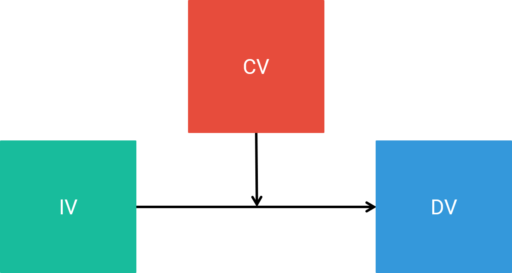

```{r}
#| label: setup
#| message: false
#| include: false

## Load packages, custom functions, and styles
source("custom-setup-styles.R")

# Set global theme with base font size 20
theme_set(theme_minimal(base_size = 20))

# Override default discrete color and fill scales
scale_colour_discrete <- function(...) scale_color_manual(values = my_palette)

# Color in math equations
# https://egallic.fr/Recherche/aide-memoire/quarto_equation_colors.html#colors-in-equations-with-revealjs
```

```{r}
#| label: fmt-helpers
#| include: false

# helpers: fixed decimals, and an APA-style version with no leading zero
fmt    <- function(x, d = 3) formatC(x, format = "f", digits = d)
fmt_nz <- function(x, d = 3) sub("^0\\.", ".", fmt(x, d))
fmt_p  <- function(p) if (p < .001) "< .001" else paste("=", fmt_nz(p))
sig    <- function(p) if (p < .05) "significant" else "not significant"

# pull one coefficient / p-value / R² from a model
b   <- function(m, term) unname(coef(m)[term])
p   <- function(m, term) summary(m)$coefficients[term, "Pr(>|t|)"]
r2  <- function(m) summary(m)$r.squared
ar2 <- function(m) summary(m)$adj.r.squared
```

# Agenda {data-menu-title="Agenda" background-image="images/calendar.png" background-size="100px" background-repeat="repeat"}

- Building models
- Interpretation in practice
- Logistic regression

::: notes
:::

# Learning objectives

By the end of the lecture, you will be able to ...

- Build and compare nested OLS models to assess mediation and moderation.
- Compare coefficients across groups and predictors.
- Estimate, interpret, and communicate logistic regression results.

# Code-along 09 {data-menu-title="Code-along" background-image="images/terminal.png"}

Download and open [code-along-09.qmd](https://www.dropbox.com/scl/fi/5ssfstlf05ofz27qej3t3/code-along-09.qmd?rlkey=tku7ens1lt8k4dlr2c6wy0zi7&st=ddlikz2o&dl=1)

## Packages {.sparse-slide}

Load the standard packages.

```{r}
#| message: false
#| label: load

library(tidyverse)
library(haven) # not core tidyverse
library(gssr)
library(gssrdoc)
library(summarytools)
library(gtsummary)
library(modelbased)
library(modelsummary)
```

## Load your data {.sparse-slide}

```{r}
#| message: false
#| label: gssdata

# Load all gss
gss22 <- gss_get_yr(2022)

```

## Variables {.sparse-slide .smaller}

- `realrinc` R's personal income in constant \$
- `lifenow` R's rating of life overall now from 0-10
- `childs` Number of children
- `mntlhlth` Days of poor mental health past 30 days
- `age` R's age
- `educ` R's highest year of school completed
- `hrs1` Hours R worked last week
- `sex` R's sex
- `marital` R's marital status
- `wtssnrps_as` survey weights

##  {.smaller data-menu-title="Variable Management"}

::: task
 Make a df with only the (pretty) categorical and
continuous variables we'll analyze.
:::

```{r}
#| message: false
#| label: my-data

# Categorical Variables
my_cat <- gss22 |>
  select(id, sex, marital) |>
  zap_missing() |>
  mutate(
    sex = as_factor(sex),
    marital = as_factor(marital)) |>
  droplevels()

# Continuous Variables
my_con <- gss22 |>
  select(id, wtssnrps_as, age, educ, hrs1, realrinc, lifenow, childs, mntlhlth) |>
  mutate(across(c(age, educ, hrs1, realrinc, lifenow, childs, mntlhlth),
                as.numeric))

# Combine the two dataframes
my_data <- full_join(my_cat, my_con, by = c("id")) |>
  drop_na() |>
  mutate(
    marital = recode(
      marital,
      "married"       = "Married",
      "never married" = "Never married",
      "widowed"       = "Div/Wid/Sep",
      "divorced"      = "Div/Wid/Sep",
      "separated"     = "Div/Wid/Sep"),
    marital = factor(
      marital,
      levels = c("Never married", "Div/Wid/Sep", "Married")),
    income10k = realrinc / 10000
  )

remove(my_con) # clean up the Environment
remove(my_cat)

# show pretty labels in regression table
coef_labels <- c(
  age = "Age",
  sexfemale = "Female",
  "maritalDiv/Wid/Sep" = "Div/Wid/Sep (ref. = never married)",
  maritalMarried = "Married",
  childs = "Children",
  educ = "Education (years)",
  hrs1 = "Work hours",
  income10k = "Income ($10k)",
  mntlhlth = "Poor mental health days",
  lifenow = "Life satisfaction",
  "educ:income10k" = "Education × Income")
```

# Building Models {.theme-section}

##  {.sparse-slide .smaller data-menu-title="Models"}

**Most analysts will run several models predicting a single outcome**  
(Model 1, Model 2, etc.)

<br>

[**Why?**]{style="color: #3498DB; font-size: 200%; font-family: 'Shadows Into Light'"}

<br>

- Elaborate on an apparent relationship between two variables
- Explore alternative (or competing) explanations
- Test whether apparent associations “hold up” under more stringent
  conditions

<br>

::: {.callout-tip icon="false"}
##  Heads Up!

Use the same sample (the same respondents) in every model you compare.
:::

##  {.sparse-slide .smaller data-menu-title="Models"}

[Several relationships may be present when a third variable (Z) is
included in the analysis of
two-variables.]{style="color: #18BC9C; font-size: 150%"}

<br>

[**Confounders**\
The relationship between X and Y is spurious—both predicted by
Z]{.fragment}

[**Covariates**\
Other variables in the model that predict Y, but mostly unrelated to the
relationship between X and Y]{.fragment}

[**Moderators**\
The relationship between X and Y depends on Z (*interactions*) *Does a
third variable change the relationship between X and Y?*]{.fragment}

[**Mediators**\
Explains the relationship between X and Y (X🡪Z🡪Y) *Does a third variable
help explain the relationship between X and Y?*]{.fragment}

## Mediators {.sparse-slide .smaller}



## Conditions for mediation {.sparse-slide .smaller}

1. IV🡪DV relationship is significant: `lm(DV ~ IV)`
2. IV🡪MV relationship is significant: `lm(MV ~ IV)`
3. MV🡪DV relationship is significant when IV is controlled:
   `lm(DV ~ IV + MV)`

<br>

::: {.callout-tip icon="false"}
##  Heads Up!

The IV🡪DV coefficient must be closer to zero when MV is controlled than
when it is not (compare models 1 and 3).
:::

::: notes
mediation can be said to occur when: 1. the IV significantly affects the
DV in the absence of the mediator 2. the IV significantly affects the
mediator 3. the mediator has a significant unique effect on the DV, and
4. the effect of the IV on the DV shrinks upon the addition of the
mediator to the model.
:::

##  {.sparse-slide data-menu-title="Code Meets Question" background-image="images/gears-solid-full.png" background-size="80px" background-repeat="repeat"}

::: task
 Does income help explain the relationship between
education and life satisfaction?
:::

```{r}
#| label: mediator-code
#| eval: FALSE

models <- list(
  "Total Effect"  = lm(lifenow ~ educ, data = my_data),
  "Path A"        = lm(income10k ~ educ, data = my_data),
  "Direct Effect" = lm(lifenow ~ educ + income10k, data = my_data)
)

modelsummary(
  models,
  title         = "OLS Regression: Income as a Mediator (No Controls)",
  statistic     = "std.error",
  stars         = c("*" = .05, "**" = .01, "***" = .001),
  coef_rename   = coef_labels,
  gof_map       = c("nobs", "r.squared")
)
```

##  {.sparse-slide .smaller data-menu-title="Mediator"}

```{r}
#| label: mediator-table
#| echo: FALSE

models <- list(
  "Total Effect"  = lm(lifenow ~ educ, data = my_data),
  "Path A"        = lm(income10k ~ educ, data = my_data),
  "Direct Effect" = lm(lifenow ~ educ + income10k, data = my_data)
)

modelsummary(
  models,
  statistic = "std.error",
  stars = c("*" = .05, "**" = .01, "***" = .001),
  coef_rename = coef_labels,
  gof_map = c("nobs", "r.squared"),
  output = "flextable") |>
  flextable::fontsize(size = 14, part = "all") |>
  flextable::padding(padding.top = 1, padding.bottom = 1, part = "all") |>
  flextable::autofit() |>
  flextable::add_header_lines("OLS Regression: Income as a Mediator (No Controls)") |>
  flextable::fontsize(i = 1, size = 20, part = "header") |>
  flextable::bold(i = 1, part = "header") |>
  flextable::align(i = 1, align = "left", part = "header")
```

```{r}
#| label: mediator-values
#| include: false

b_total  <- b(models[["Total Effect"]], "educ")
b_direct <- b(models[["Direct Effect"]], "educ")
pct_red  <- (b_total - b_direct) / b_total

r2_total <- r2(models[["Total Effect"]])
r2_full  <- r2(models[["Direct Effect"]])

p_direct <- p(models[["Direct Effect"]], "educ")
```

##  {.sparse-slide .smaller data-menu-title="Conclusion" background-image="images/gears-solid-full.png" background-size="80px" background-repeat="repeat"}

::: task
 Does income help explain the relationship between
education and life satisfaction?
:::

**Lesson 1:** Coefficients can change when a mediator is added.

- Education's coefficient falls from `r fmt(b_total)` to
  `r fmt(b_direct)`
- About a `r round(pct_red * 100)`% reduction

> $\frac{`r fmt(b_total)` - `r fmt(b_direct)`}{`r fmt(b_total)`} \approx `r fmt(pct_red, 2)`$

- `r if (p_direct < .05) "Evidence of partial mediation: the direct effect shrinks but remains statistically significant" else "Consistent with full mediation: the direct effect is no longer statistically significant"`
  (*p* `r fmt_p(p_direct)`)

::: fragment
**Lesson 2:** Model fit can improve when theoretically important
variables are included.

- $R^2$ increases from `r fmt_nz(r2_total)` to `r fmt_nz(r2_full)`
- Income explains additional variation in life satisfaction beyond
  education alone
:::

## Mediation in a Paper {.sparse-slide .smaller}

::: task
 Does income help explain the association between
education and life satisfaction, net of controls?
:::

<br>

```{r}
#| label: paper-mediator
#| eval: FALSE
#| code-line-numbers: "2|3,4|5,6"

models_med <- list(
  "Model 1: Education"  = lm(lifenow ~ educ, data = my_data),
  "Model 2: + Controls" = lm(lifenow ~ educ + age + sex + marital + childs,
                             data = my_data),
  "Model 3: + Income"   = lm(lifenow ~ educ + age + sex + marital + childs
                             + income10k, data = my_data)
)

modelsummary(
  models_med,
  title = "OLS Regression of Life Satisfaction: Income as a Mediator, Net of Controls",
  statistic   = "std.error",
  stars       = c("*" = .05, "**" = .01, "***" = .001),
  coef_rename = coef_labels,
  gof_map     = c("nobs", "adj.r.squared")
)
```

##  {.sparse-slide data-menu-title="Mediation in a Paper"}

```{r}
#| label: paper-mediator-table
#| echo: FALSE

models_med <- list(
  "Model 1: Education"  = lm(lifenow ~ educ, data = my_data),
  "Model 2: + Controls" = lm(lifenow ~ educ + age + sex + marital + childs,
                             data = my_data),
  "Model 3: + Income"   = lm(lifenow ~ educ + age + sex + marital + childs
                             + income10k, data = my_data)
)

modelsummary(
  models_med,
  statistic = "std.error",
  stars = c("*" = .05, "**" = .01, "***" = .001),
  coef_rename = coef_labels,
  gof_map = c("nobs", "adj.r.squared"),
  output = "flextable") |>
  flextable::fontsize(size = 14, part = "all") |>
  flextable::padding(padding.top = 1, padding.bottom = 1, part = "all") |>
  flextable::autofit() |>
  flextable::add_header_lines("OLS Regression of Life Satisfaction: Income as a Mediator, Net of Controls") |>
  flextable::fontsize(i = 1, size = 20, part = "header") |>
  flextable::bold(i = 1, part = "header") |>
  flextable::align(i = 1, align = "left", part = "header")
```

```{r}
#| label: paper-mediator-values
#| include: false

med_b1 <- b(models_med[[1]], "educ")
med_b2 <- b(models_med[[2]], "educ")
med_b3 <- b(models_med[[3]], "educ")
med_pct_ctrl <- (med_b1 - med_b2) / med_b1
med_pct_med  <- (med_b2 - med_b3) / med_b2
med_p2 <- p(models_med[[2]], "educ")
med_p3 <- p(models_med[[3]], "educ")

# path a (education -> income), same controls; not shown in the table
med_path_a <- lm(income10k ~ educ + age + sex + marital + childs, data = my_data)
med_b_a    <- b(med_path_a, "educ")
med_p_a    <- p(med_path_a, "educ")

# path b (income -> life satisfaction, net of education and controls)
med_b_inc  <- b(models_med[[3]], "income10k")
med_p_inc  <- p(models_med[[3]], "income10k")
```

::: notes
Same question as the earlier example, now with controls. Only income is
added in Model 3. Model 1: unadjusted association (educ =
`r fmt(med_b1)`). Model 2: net of controls, the total effect (educ =
`r fmt(med_b2)`, p `r fmt_p(med_p2)`). Model 3: net of controls and
income, the direct effect (educ = `r fmt(med_b3)`, p `r fmt_p(med_p3)`).
Controls change the educ coefficient by `r round(med_pct_ctrl * 100)`%
(Model 1 to 2); adding income changes it by another
`r round(med_pct_med * 100)`% (Model 2 to 3). Path a (not in table):
education → income = `r fmt(med_b_a)` (p `r fmt_p(med_p_a)`). Path b:
income → life satisfaction = `r fmt(med_b_inc)` (p
`r fmt_p(med_p_inc)`). The shrinkage is descriptive. It is not a test of
the indirect effect.
:::

## Moderation in a Paper {.sparse-slide .smaller}

::: task
 Does the association between education and life
satisfaction depend on income?
:::

```{r}
#| label: paper-moderator
#| eval: FALSE
#| code-line-numbers: "2|3,4|5,6"

models_mod <- list(
  "Model 1: Education"     = lm(lifenow ~ educ, data = my_data),
  "Model 2: + Income & Controls" = lm(lifenow ~ educ + income10k + age + sex + marital + childs,
                                data = my_data),
  "Model 3: + Interaction" = lm(lifenow ~ educ * income10k + age + sex + marital + childs,
                                data = my_data)
)

modelsummary(
  models_mod,
  title = "OLS Regression of Life Satisfaction: Education × Income Interaction",
  statistic   = "std.error",
  stars       = c("*" = .05, "**" = .01, "***" = .001),
  coef_rename = coef_labels,
  gof_map     = c("nobs", "adj.r.squared")
)
```

##  {.sparse-slide data-menu-title="Moderation in a Paper"}

```{r}
#| label: paper-moderator-table
#| echo: FALSE

models_mod <- list(
  "Model 1: Education"     = lm(lifenow ~ educ, data = my_data),
  "Model 2: + Income & Controls" = lm(lifenow ~ educ + income10k + age + sex + marital + childs,
                                data = my_data),
  "Model 3: + Interaction" = lm(lifenow ~ educ * income10k + age + sex + marital + childs,
                                data = my_data)
)

modelsummary(
  models_mod,
  statistic = "std.error",
  stars = c("*" = .05, "**" = .01, "***" = .001),
  coef_rename = coef_labels,
  gof_map = c("nobs", "adj.r.squared"),
  output = "flextable") |>
  flextable::fontsize(size = 14, part = "all") |>
  flextable::padding(padding.top = 1, padding.bottom = 1, part = "all") |>
  flextable::autofit() |>
  flextable::add_header_lines("OLS Regression of Life Satisfaction: Education × Income Interaction") |>
  flextable::fontsize(i = 1, size = 20, part = "header") |>
  flextable::bold(i = 1, part = "header") |>
  flextable::align(i = 1, align = "left", part = "header")
```

```{r}
#| label: paper-moderator-values
#| include: false

mod3     <- models_mod[[3]]
int_term <- grep("^educ:income10k", names(coef(mod3)), value = TRUE)[1]

mod_b_educ <- b(mod3, "educ")      # slope of educ when income = 0
mod_b_int  <- b(mod3, int_term)    # change in the educ slope per $10k of income
mod_p_int  <- p(mod3, int_term)

# education slope at representative incomes (in $10k): $10k, $25k, $50k
incs       <- c(1, 2.5, 5)
mod_slopes <- setNames(mod_b_educ + mod_b_int * incs, incs)
```

::: notes
Model 2 here is the same model as Model 3 on the mediation slide.
Mediation asked: does the educ coefficient shrink when income enters?
(Yes.) Moderation asks a different question: does the educ slope itself
depend on income? Income is in Model 2 because an interaction model must
include both main effects. Model 3 adds one coefficient (Education ×
Income = `r fmt(mod_b_int, 4)`, p `r fmt_p(mod_p_int)`). Here the change
in slope is `r sig(mod_p_int)`. Lesson: mediation and moderation are different
questions; a variable can explain *why* without changing *how strongly*, or vice versa. In Model
3, the Education coefficient (`r fmt(mod_b_educ)`) is the slope at \$0
income, the bottom edge of the data. Slopes at real incomes: \$10k =
`r fmt(mod_slopes["1"])`, \$25k = `r fmt(mod_slopes["2.5"])`, \$50k =
`r fmt(mod_slopes["5"])`. Show slopes across incomes with
estimate_slopes(models_mod\[\[3\]\], trend = "educ", by = "income10k").
:::

## Moderation vs Mediation {.smaller .sparse-slide}

::: {style="font-size: 80%;"}
+--------------+---------------------------------------------------------------------------------------------------------+-----------------------------------------+
|              | **Mediation**                                                                                           | **Moderation**                          |
+:=============+:========================================================================================================+:========================================+
| **Question** | Does income help explain the relationship between education and life satisfaction?                      | Does the relationship between education |
|              |                                                                                                         | and life satisfaction depend on income? |
+--------------+---------------------------------------------------------------------------------------------------------+-----------------------------------------+
| **Concept**  | Income explains **why** education is associated with life satisfaction.                                 | Income changes **how strongly**         |
|              |                                                                                                         | education is associated with life       |
|              |                                                                                                         | satisfaction.                           |
+--------------+---------------------------------------------------------------------------------------------------------+-----------------------------------------+
| **Model**    | `lifenow ~ educ + controls`<br>`income10k ~ educ + controls`<br>`lifenow ~ educ + income10k + controls` | `lifenow ~ educ * income10k + controls` |
+--------------+---------------------------------------------------------------------------------------------------------+-----------------------------------------+
| **Look at**  | Does the `educ` coefficient shrink when `income10k` is added?                                           | Is the `educ:income10k` coefficient     |
|              |                                                                                                         | significant?                            |
+--------------+---------------------------------------------------------------------------------------------------------+-----------------------------------------+
:::

::: aside
Formal test of the indirect effect: `mediation::mediate()` or `lavaan::sem()`
:::

## Theory-driven blocks {.sparse-slide .smaller}

::: task
 What predicts life satisfaction?
:::

```{r}
#| label: paper-blocks
#| eval: FALSE
#| code-line-numbers: "2|3,4|5,6|7,8"

models_blocks <- list(
  "Model 1: Demographic"   = lm(lifenow ~ age + sex + educ, data = my_data),
  "Model 2: + Family"      = lm(lifenow ~ age + sex + educ + marital + childs,
                                data = my_data),
  "Model 3: + Economic"    = lm(lifenow ~ age + sex + educ + marital + childs
                                + hrs1 + income10k, data = my_data),
  "Model 4: + Mental health" = lm(lifenow ~ age + sex + educ + marital + childs
                                + hrs1 + income10k + mntlhlth, data = my_data)
)

modelsummary(
  models_blocks,
  title = "OLS Regression of Life Satisfaction: Nested Blocks of Predictors",
  statistic   = "std.error",
  stars       = c("*" = .05, "**" = .01, "***" = .001),
  coef_rename = coef_labels,
  gof_map     = c("nobs", "adj.r.squared")
)
```

##  {.sparse-slide data-menu-title="Theory-driven blocks"}

```{r}
#| label: paper-blocks-table
#| echo: FALSE

models_blocks <- list(
  "Model 1: Demographic"   = lm(lifenow ~ age + sex + educ, data = my_data),
  "Model 2: + Family"      = lm(lifenow ~ age + sex + educ + marital + childs,
                                data = my_data),
  "Model 3: + Economic"    = lm(lifenow ~ age + sex + educ + marital + childs
                                + hrs1 + income10k, data = my_data),
  "Model 4: + Mental health" = lm(lifenow ~ age + sex + educ + marital + childs
                                + hrs1 + income10k + mntlhlth, data = my_data)
)

modelsummary(
  models_blocks,
  statistic = "std.error",
  stars = c("*" = .05, "**" = .01, "***" = .001),
  coef_rename = coef_labels,
  gof_map = c("nobs", "adj.r.squared"),
  output = "flextable") |>
  flextable::fontsize(size = 14, part = "all") |>
  flextable::padding(padding.top = 1, padding.bottom = 1, part = "all") |>
  flextable::autofit() |>
  flextable::add_header_lines("OLS Regression of Life Satisfaction: Nested Blocks of Predictors") |>
  flextable::fontsize(i = 1, size = 20, part = "header") |>
  flextable::bold(i = 1, part = "header") |>
  flextable::align(i = 1, align = "left", part = "header")
```

```{r}
#| label: paper-blocks-values
#| include: false

blk_ar2   <- sapply(models_blocks, ar2)
blk_delta <- diff(blk_ar2)
blk_n     <- sapply(models_blocks, nobs)
```

::: notes
Each model keeps all earlier blocks.\
Read across a row to see how a coefficient changes when a block enters,
and down the R² row to see how much each block adds.\
Adjusted R²: `r paste(fmt_nz(blk_ar2), collapse = " → ")` (change:
family `r fmt(blk_delta[1])`, economic `r fmt(blk_delta[2])`, mental
health `r fmt(blk_delta[3])`). N across models:
`r paste(blk_n, collapse = ", ")`.
`r if (length(unique(blk_n)) > 1) "Ns differ, so the R² changes partly reflect different samples." else ""`
Marital status adds two coefficients, so judge the block by the change
in R², not by one t-test.\
Block order is a theoretical claim: mental health could be a cause or a
consequence of life satisfaction.
:::

# Interpretation in Practice {.theme-section}

## Comparing between models {.sparse-slide .smaller}

::: task
 Is education equally associated with life satisfaction for men and women?
:::

```{r}
#| label: paper-compare
#| eval: FALSE
#| code-line-numbers: "1,2|4,5"

m_men <- lm(lifenow ~ educ + age + marital + childs + income10k,
            data = subset(my_data, sex == "male"))
  
m_women <- lm(lifenow ~ educ + age + marital + childs + income10k,
              data = subset(my_data, sex == "female"))

modelsummary(
  list("Men" = m_men, "Women" = m_women),
  title = "OLS Regression of Life Satisfaction: Separate Models by Gender",
  statistic   = "std.error",
  stars       = c("*" = .05, "**" = .01, "***" = .001),
  coef_rename = coef_labels,
  gof_map     = c("nobs", "adj.r.squared")
)
```


##  {.sparse-slide data-menu-title="Comparing between models"}

```{r}
#| label: paper-compare-table
#| echo: FALSE

m_men <- lm(lifenow ~ educ + age + marital + childs + income10k,
            data = subset(my_data, sex == "male"))
  
m_women <- lm(lifenow ~ educ + age + marital + childs + income10k,
              data = subset(my_data, sex == "female"))

modelsummary(
  list("Men" = m_men, "Women" = m_women),
  statistic = "std.error",
  stars = c("*" = .05, "**" = .01, "***" = .001),
  coef_rename = coef_labels,
  gof_map = c("nobs", "adj.r.squared"),
  output = "flextable") |>
  flextable::fontsize(size = 14, part = "all") |>
  flextable::padding(padding.top = 1, padding.bottom = 1, part = "all") |>
  flextable::autofit() |>
  flextable::add_header_lines("OLS Regression of Life Satisfaction: Separate Models by Gender") |>
  flextable::fontsize(i = 1, size = 20, part = "header") |>
  flextable::bold(i = 1, part = "header") |>
  flextable::align(i = 1, align = "left", part = "header")
```

##  {data-menu-title="Comparing between models" .sparse-slide .smaller}

[**You must formally test whether coefficients differ across models!**]{style="color: #E74C3C; font-family: 'Shadows Into Light'"}

Null hypothesis:

$$
H_0: b_{educ,m}=b_{educ,w}
$$

The coefficient difference test is:

$$
z =
\frac{b_{educ,m}-b_{educ,w}}
{\sqrt{SE^2_{educ,m}+SE^2_{educ,w}}}
$$

where:  
  
$b_{educ,m}$ = education coefficient for men  
$b_{educ,w}$ = education coefficient for women  

## {data-menu-title="Comparing between models" .smaller}

```{r}
#| label: paper-compare-z-test
#| output-location: fragment

z_test <- function(m1, m2, term, vc = vcov) {
  b1  <- unname(coef(m1)[term])
  b2  <- unname(coef(m2)[term])
  se1 <- sqrt(vc(m1)[term, term])
  se2 <- sqrt(vc(m2)[term, term])
  z   <- (b1 - b2) / sqrt(se1^2 + se2^2)
  c(b_1 = b1, b_2 = b2, diff = b1 - b2, z = z, p = 2 * pnorm(-abs(z)))
}

compare <- z_test(m_men, m_women, "educ")

compare

```
```{r}
#| label: paper-compare-values
#| include: false

b_men   <- b(m_men, "educ")
b_women <- b(m_women, "educ")
p_men   <- p(m_men, "educ")
p_women <- p(m_women, "educ")
p_educ  <- compare[["p"]]

```

<br>

::: {.fragment style="font-size: 70%;"}

[**A package is safer than hand-coding the z-test: it estimates both models jointly and uses robust standard errors**]{style="color: #3498DB; font-family: 'Shadows Into Light'"}

```{r}
#| label: paper-compare-suest
#| eval: false

# install.packages("remotes")
# remotes::install_github("tdmize/suest")

library(suest)
library(marginaleffects)

combined <- suest(m_men, m_women)

effects_groups <- marginaleffects::avg_comparisons(combined, variables = "educ",
                                  newdata = suest_newdata(combined))
effects_groups

marginaleffects::hypotheses(effects_groups, hypothesis = difference ~ revpairwise)

```

:::

## Comparing between models {.sparse-slide}

Education was positively and statistically significantly associated with life satisfaction
among women (*b* = `r fmt(b_women)`, *p* `r fmt_p(p_women)`) but not among men
(*b* = `r fmt(b_men)`, *p* `r fmt_p(p_men)`). However, a formal test showed that
the two coefficients did not differ significantly (*p* `r fmt_p(p_educ)`). The data therefore do not support the conclusion that education matters more for women's life satisfaction than for men's.

::: notes
*How could that be? One coef. was significant and the other was not!... next slide
:::

## {data-menu-title="Comparing between models" .smaller}

```{r}
#| label: paper-compare-models
#| echo: FALSE

# The three approaches
m_pooled <- lm(lifenow ~ educ + age + sex + marital + childs + income10k, data = my_data)
m_one    <- lm(lifenow ~ educ * sex + age + marital + childs + income10k, data = my_data)
m_men    <- lm(lifenow ~ educ + age + marital + childs + income10k, data = subset(my_data, sex == "male"))
m_women  <- lm(lifenow ~ educ + age + marital + childs + income10k, data = subset(my_data, sex == "female"))

# Population-averaged predictions
pm <- function(mod, by, label, sex = NULL) {
  out <- as.data.frame(estimate_means(mod, by = by, estimate = "population"))
  if (!is.null(sex)) out$sex <- sex          # separate models: no sex variable inside
  out$approach <- label
  out
}

preds <- bind_rows(
  pm(m_pooled, c("sex", "educ = c(12:20)"), "Pooled"),
  pm(m_one,    c("sex", "educ = c(12:20)"), "1 interaction"),
  pm(m_men,    "educ = c(12:20)", "Separate models", sex = "male"),
  pm(m_women,  "educ = c(12:20)", "Separate models", sex = "female")) |>
  mutate(sex      = factor(sex, levels = c("male", "female")),
         approach = factor(approach, levels = c("Pooled", "1 interaction", "Separate models")))

ggplot(preds, aes(educ, Mean, color = sex, fill = sex)) +
#  geom_ribbon(aes(ymin = CI_low, ymax = CI_high), alpha = 0.12, color = NA) +
  geom_line(aes(linetype = sex), linewidth = 1) +
  geom_point(size = 2.5) +
  facet_wrap(~ approach) +
  scale_color_manual(values = c(male = "#3498DB", female = "#E74C3C")) +
  scale_fill_manual(values  = c(male = "#3498DB", female = "#E74C3C")) +
  scale_x_continuous(breaks = seq(12, 20, 2), expand = expansion(mult = c(0.03, 0.18))) +
  labs(
    title = "Predicted life satisfaction (0-10) by gender and education",
    x = "Education (years)", y = "Predicted life satisfaction",
    color = NULL, fill = NULL, linetype = NULL,
    caption = "Data: US General Social Survey (2022)
    Population-averaged predictions (modelbased::estimate_means).") +
  theme(legend.position = "bottom",
        panel.grid.minor = element_blank(),
        strip.text = element_text(face = "bold"),
        plot.caption = element_text(color = "grey40", size = 10))
```

::: notes
**Pooled and 1 interaction**: for each sex, the model predicts every respondent's life satisfaction as if they had that sex and that education level, using everyone's own control values.  
It then averages over the whole sample.  
  
**Separate models**: the men's line averages over men's control values and the women's line over women's.  
Part of the gap comes from men and women having different control values, such as income or marriage rates.  
:::


## {data-menu-title="Comparing between models" .smaller}

::: {style="font-size: 80%;"}
+-----------------------------------------------------------------+---------------+
| Model Approach                                                  | Assumption    |
+=================================================================+===============+
| **Pooled**                                                      | Men and women |
|                                                                 | differ only   |
| `lifenow ~ educ + sex + CVs, data = my_data`                    | in the        |
|                                                                 | intercept.    |
|                                                                 | Every slope   |
|                                                                 | is the same.  |
+-----------------------------------------------------------------+---------------+
| **1 interaction**                                               | `educ` slope  |
|                                                                 | differs by    |
| `lifenow ~ educ * sex + CVs, data = my_data`                    | `sex`. All    |
|                                                                 | other slopes  |
|                                                                 | equal.        |
+-----------------------------------------------------------------+---------------+
| **Separate models** (or fully interacted model)                 | Every slope   |
|                                                                 | and the       |
| `lifenow ~ educ + CVs, data = subset(my_data, sex == "male")`   | intercept can |
|                                                                 | differ by     |
| `lifenow ~ educ + CVs, data = subset(my_data, sex == "female")` | sex.          |
+-----------------------------------------------------------------+---------------+
:::


## Standardized regression coefficients {.sparse-slide .smaller}

::: task
 Is education or income more strongly associated with life satisfaction?
:::

<br>

```{r}
#| label: std-coef
#| eval: FALSE
#| code-line-numbers: "1,2|4,5"

mod_01 <- lm(lifenow ~ educ + income10k + sex + age + marital + childs,
            data = my_data)
  
mod_02 <- lm(lifenow ~ scale(educ) + scale(income10k) + sex + age + marital + childs,
            data = my_data)

modelsummary(
  list("Unstandardized" = mod_01, "Standardized" = mod_02),
  title = "OLS Regression of Life Satisfaction: Unstandardized and Standardized Coefficients",
  statistic   = "std.error",
  stars       = c("*" = .05, "**" = .01, "***" = .001),
  coef_rename = coef_labels,
  gof_map     = c("nobs", "adj.r.squared")
)
```

::: notes
[tutorial](https://murraylax.org/rtutorials/multregression_standardized.html)
:::


##  {.sparse-slide data-menu-title="Standardized regression coefficients"}

```{r}
#| label: paper-std-coef-table
#| echo: FALSE

mod_01 <- lm(lifenow ~ educ + income10k + sex + age + marital + childs,
            data = my_data)
  
mod_02 <- lm(lifenow ~ scale(educ) + scale(income10k) + sex + age + marital + childs,
            data = my_data)

modelsummary(
  list("Unstandardized" = mod_01, "Standardized" = mod_02),
  statistic = "std.error",
  stars = c("*" = .05, "**" = .01, "***" = .001),
  coef_rename = coef_labels,
  gof_map = c("nobs", "adj.r.squared"),
  output = "flextable") |>
  flextable::fontsize(size = 14, part = "all") |>
  flextable::padding(padding.top = 1, padding.bottom = 1, part = "all") |>
  flextable::autofit() |>
  flextable::add_header_lines("OLS Regression of Life Satisfaction: Unstandardized and Standardized Coefficients") |>
  flextable::fontsize(i = 1, size = 20, part = "header") |>
  flextable::bold(i = 1, part = "header") |>
  flextable::align(i = 1, align = "left", part = "header")
```


## Standardized regression coefficients {.sparse-slide .smaller}

[**How much is 1 standard deviation change?**]{style="color: #3498DB; font-family: 'Shadows Into Light'"}  

```{r}
sd(my_data$educ)
sd(my_data$income10k) * 10000
```
```{r}
#| label: paper-std-coef-interp01
#| echo: FALSE

sd_educ   <- sd(my_data$educ)
sd_income <- sd(my_data$income10k) * 10000
```

<br>

::: {.fragment}

[**Is the coefficient difference statistically significant?**]{style="color: #3498DB; font-family: 'Shadows Into Light'"}  

```{r}
#| label: paper-std-coef-interp02

V_std <- vcov(mod_02)
b_std <- coef(mod_02)
inc <- "scale(income10k)"
edu <- "scale(educ)"

std_diff <- unname(b_std[inc] - b_std[edu])
std_z    <- std_diff / sqrt(V_std[inc, inc] + V_std[edu, edu] - 2 * V_std[inc, edu])
std_p    <- 2 * pnorm(-abs(std_z))

round(c(diff = std_diff, z = std_z, p = std_p), 3)

```
:::

::: notes
A larger β isn't automatically "more important."  
It means a typical amount of variation in that variable goes with more change in the outcome.  
Standardized coefficients depend on how spread out each variable is in this sample.  
  
Bigger isn't the same as significantly bigger.
To test whether the education and income β's actually differ, use the formula from earlier (plus account for covariance since in same model)  
:::

## Standardized regression coefficients {.sparse-slide}
  
Holding the other variables constant, a one-standard-deviation increase in education (`r round(sd_educ, 1)` years) is associated with a `r fmt(unname(b_std[edu]), 2)`-point increase in life satisfaction, and a one-standard-deviation increase in income (\$`r format(round(sd_income, -3), big.mark = ",")`) with a `r fmt(unname(b_std[inc]), 2)`-point increase. `r if (std_diff > 0) "Income" else "Education"` is therefore somewhat more strongly associated with life satisfaction, `r if (std_p < .05) "and the difference is statistically significant" else "but the difference is not statistically significant"` (*p* `r fmt_p(std_p)`).

::: notes
the coefficients for female, age, marital status and children are identical in the two columns, because those variables weren't rescaled. The intercept changes because education and income are now centered at their means. The new intercept is the predicted life satisfaction at average education and income, for the reference groups (male, never married) at age 0 with no children. Adjusted R² is the same in both columns, so standardizing changes the units of the coefficients and nothing about how well the model fits.
:::

## Survey weights {.sparse-slide .smaller}

[Weights let respondents who are under-represented in the survey compared with the population count more, and those who are over-represented count less.]{style="color: #3498DB; font-family: 'Shadows Into Light'"}  

<br>  

```{r}
#| label: survey-weights
#| eval: FALSE
#| code-line-numbers: "1,2|4,5"

m_unwt <- lm(lifenow ~ educ + income10k + sex + age + marital + childs,
             data = my_data)

m_wt   <- lm(lifenow ~ educ + income10k + sex + age + marital + childs,
             data = my_data, weights = wtssnrps_as)

modelsummary(
  list("Unweighted" = m_unwt, "Weighted" = m_wt),
  title = "OLS Regression of Life Satisfaction: Unweighted and Weighted Estimates",
  statistic   = "std.error",
  stars       = c("*" = .05, "**" = .01, "***" = .001),
  coef_rename = coef_labels,
  gof_map     = c("nobs", "adj.r.squared")
)
```


## {data-menu-title="Survey weights" .sparse-slide}

```{r}
#| label: survey-weights-compare
#| echo: FALSE

m_unwt <- lm(lifenow ~ educ + income10k + sex + age + marital + childs,
             data = my_data)

m_wt   <- lm(lifenow ~ educ + income10k + sex + age + marital + childs,
             data = my_data, weights = wtssnrps_as)

modelsummary(
  list("Unweighted" = m_unwt, "Weighted" = m_wt),
  statistic = "std.error",
  stars = c("*" = .05, "**" = .01, "***" = .001),
  coef_rename = coef_labels,
  gof_map = c("nobs", "adj.r.squared"),
  output = "flextable") |>
  flextable::fontsize(size = 14, part = "all") |>
  flextable::padding(padding.top = 1, padding.bottom = 1, part = "all") |>
  flextable::autofit() |>
  flextable::add_header_lines("OLS Regression of Life Satisfaction: Unweighted and Weighted Estimates") |>
  flextable::fontsize(i = 1, size = 20, part = "header") |>
  flextable::bold(i = 1, part = "header") |>
  flextable::align(i = 1, align = "left", part = "header")
```

::: notes
Weights mainly change the **coefficients**, so the weighted model describes the U.S. population rather than our sample
- `lm(weights = )` gives correct coefficients, but its **standard errors are approximate**. For publication, use the `survey` package with the GSS design variables (`vpsu`, `vstrat`)
:::


# Logistic Regression {.theme-section}

## Logistic Regression {.smaller}

```{r}
#| label: logit
#| eval: FALSE
#| code-line-numbers: "2,3,4,5|8,9|10,11"

# Dichotomize lifenow (0-10) at the sample mean
avg_life <- mean(my_data$lifenow)

my_data <- my_data |>
  mutate(sat_high = if_else(lifenow > avg_life, 1, 0))

# The two models
m_ols   <- lm(sat_high ~ educ + income10k + sex + age + marital + childs,
              data = my_data)
m_logit <- glm(sat_high ~ educ + income10k + sex + age + marital + childs,
               data = my_data, family = binomial)

modelsummary(
  list("OLS" = m_ols, "Logit" = m_logit),
  title = "OLS vs. Logistic Regression of Above-Average Life Satisfaction",
  statistic   = "std.error",
  stars       = c("*" = .05, "**" = .01, "***" = .001),
  coef_rename = coef_labels,
  gof_map     = c("nobs", "adj.r.squared")
)
```


## {data-menu-title="Logistic Regression" .sparse-slide .smaller}

:::: {.columns}
::: {.column width="55%"}

```{r}
#| label: logit-compare
#| echo: FALSE

# Dichotomize lifenow (0-10) at the sample mean
avg_life <- mean(my_data$lifenow)

my_data <- my_data |>
  mutate(sat_high = if_else(lifenow > avg_life, 1, 0))

# The two models
m_ols   <- lm(sat_high ~ educ + income10k + sex + age + marital + childs,
              data = my_data)
m_logit <- glm(sat_high ~ educ + income10k + sex + age + marital + childs,
               data = my_data, family = binomial)

modelsummary(
  list("OLS" = m_ols, "Logit" = m_logit),
  statistic = "std.error",
  stars = c("*" = .05, "**" = .01, "***" = .001),
  coef_rename = coef_labels,
  gof_map = c("nobs", "adj.r.squared"),
  output = "flextable") |>
  flextable::fontsize(size = 14, part = "all") |>
  flextable::padding(padding.top = 1, padding.bottom = 1, part = "all") |>
  flextable::autofit() |>
  flextable::add_header_lines("OLS vs. Logistic Regression of Above-Average Life Satisfaction") |>
  flextable::fontsize(i = 1, size = 20, part = "header") |>
  flextable::bold(i = 1, part = "header") |>
  flextable::align(i = 1, align = "left", part = "header")
```

```{r}
#| label: logit-values
#| include: false

# Inline numbers used in the text
fit_ols  <- fitted(m_ols)
n_out    <- sum(fit_ols < 0 | fit_ols > 1)
rng_ols  <- round(range(fit_ols), 2)
b_educ   <- round(coef(m_logit)["educ"], 3)
or_educ  <- round(exp(coef(m_logit)["educ"]), 3)
pct_educ <- round((exp(coef(m_logit)["educ"]) - 1) * 100, 1)
or_mar   <- round(exp(coef(m_logit)["maritalMarried"]), 1)
pct_mar  <- round((exp(coef(m_logit)["maritalMarried"]) - 1) * 100, 1)
```

:::

::: {.column width="45%"}
The model is on the **log‑odds** scale:

$$\ln\!\left(\frac{p}{1-p}\right) = \beta_0 + \beta_1 \text{educ} + \dots$$

- Education: **b = `r b_educ`**. Each extra year of schooling changes the *log odds* of above-average satisfaction by `r b_educ`.
- The sign is easy to read (+ means more likely, − means less likely), but the size is hard to interpret.
- To get an interpretable size, convert to **odds** or **probabilities**.
:::
::::


## {data-menu-title="Logistic Regression" .sparse-slide}

```{r}
#| label: logit-figs
#| layout-ncol: 2
#| fig-width: 5.5
#| fig-height: 4.5
#| echo: FALSE

base <- ggplot(my_data, aes(educ, sat_high)) +
  geom_jitter(height = 0.04, width = 0.3, alpha = 0.10, colour = "grey40") +
  geom_hline(yintercept = c(0, 1), linetype = "dashed", colour = "grey40") +
  scale_x_continuous(limits = c(-10, 40)) +
  coord_cartesian(ylim = c(-0.4, 1.4)) +
  labs(x = "Years of education",
       y = "Probability above-average life satisfaction") +
  theme_minimal(base_size = 13)

base +
  geom_smooth(method = "lm", fullrange = TRUE, se = FALSE,
              colour = "#E74C3C", linewidth = 1.2) +
  labs(title = "OLS")

base +
  geom_smooth(method = "glm", method.args = list(family = binomial),
              fullrange = TRUE, se = FALSE,
              colour = "#3498DB", linewidth = 1.2) +
  labs(title = "Logistic regression")
```

::: notes

line vs. S‑curve

- **`sat_high`** = 1 if above average, 0 if at or below average.
- DV is now **binary**, so what we model is a **probability**, and a probability can only fall between **0 and 1**.
- OLS assumes the DV can take any value from −∞ to +∞. A straight line keeps going past 0 and 1.

In the full OLS model, **`r n_out`** predicted values fall outside 0–1 (range: `r rng_ols[1]` to `r rng_ols[2]`).
:::


## {data-menu-title="Logistic Regression" .sparse-slide}

```{r}
#| label: log-odds-ratios
#| eval: FALSE
#| code-line-numbers: "8"

m_logit <- glm(sat_high ~ educ + income10k + sex + age + marital + childs,
               data = my_data, family = binomial)

# Same model with different scales
modelsummary(
  list("Log odds"    = m_logit,
       "Odds ratios" = m_logit),
  exponentiate = c(FALSE, TRUE),
  title = "Logistic Regression of Above-Average Life Satisfaction: Log Odds and Odds Ratios",
  statistic   = "std.error",
  stars       = c("*" = .05, "**" = .01, "***" = .001),
  coef_rename = coef_labels,
  gof_map     = "nobs"
)
```


## {data-menu-title="Logistic Regression" .sparse-slide .smaller}

:::: {.columns}

::: {.column width="60%"}

```{r}
#| label: logit-table
#| echo: FALSE

m_logit <- glm(sat_high ~ educ + income10k + sex + age + marital + childs,
               data = my_data, family = binomial)

# One table, two scales
modelsummary(
  list("Log odds"    = m_logit,
       "Odds ratios" = m_logit),
  exponentiate = c(FALSE, TRUE),
  statistic = "std.error",
  stars = c("*" = .05, "**" = .01, "***" = .001),
  coef_rename = coef_labels,
  gof_map = "nobs",
  output = "flextable") |>
  flextable::fontsize(size = 14, part = "all") |>
  flextable::padding(padding.top = 1, padding.bottom = 1, part = "all") |>
  flextable::autofit() |>
  flextable::add_header_lines("Logistic Regression of Above-Average Life Satisfaction: Log Odds and Odds Ratios") |>
  flextable::fontsize(i = 1, size = 20, part = "header") |>
  flextable::bold(i = 1, part = "header") |>
  flextable::align(i = 1, align = "left", part = "header")
```

:::

::: {.column width="40%"}

$e^{`r b_educ`}$ = **`r or_educ`** (an *odds ratio*).

Each extra year of education multiplies the odds by `r or_educ`, a **`r pct_educ`%** change in the odds.  

<br>

Married respondents' odds of above-average life satisfaction are about **`r or_mar`** times those of never-married respondents, a **`r pct_mar`%** increase in the odds.

<br>
  
- OR > 1 means higher odds
- OR < 1 means lower odds
- OR = 1 means no effect

:::
::::

## Log Odds, Odds, & Probabilities {.sparse-slide .smaller}

| Step | Formula | Range |
|---|---|---|
| Probability | $p$ | 0 to 1 |
| Odds | $p/(1-p)$ | 0 to ∞ |
| Log odds | $\ln(\text{odds})$ | −∞ to +∞ |
| **Back to odds** | $e^{b}$ | |
| **Back to p** | $\text{odds}/(1+\text{odds})$ | |

## Log Odds, Odds, & Probabilities {.sparse-slide .smaller}

```{r}
#| label: pp-fig
#| echo: FALSE

aap_inc <- estimate_means(m_logit, by = "income10k",
                          estimate = "population", length = 25)

ggplot(aap_inc, aes(income10k, Probability)) +
  geom_ribbon(aes(ymin = CI_low, ymax = CI_high), fill = "#3498DB", alpha = 0.2) +
  geom_line(colour = "#3498DB", linewidth = 1.2) +
  scale_y_continuous(limits = c(0, 1), labels = scales::percent) +
  labs(x = "Income ($10k)",
       y = "Average adjusted predicted probability",
       title = "Predicted probability of above average life satisfaction",
       caption = "Data: US General Social Survey (2022)") +
  theme_minimal(base_size = 14)
```

::: notes
- An odds ratio stays the same across the range, but **the change in probability depends on where you start**. That is why the curve bends.
- Report predicted probabilities when you present results.
:::

## {data-menu-title="Logistic Regression" .sparse-slide .smaller}

:::: {.columns}

::: {.column width="65%"}

```{r}
#| label: AME-table
#| echo: FALSE

ame <- marginaleffects::avg_slopes(m_logit)

# Rename factor AMEs (e.g., "female - male") to match glm's names (e.g., "sexfemale")
ame$term <- if_else(
  ame$contrast %in% c("dY/dX", "dY/dX "),
  ame$term,
  paste0(ame$term,
         ame$contrast |>
           str_remove_all("mean\\(|\\)") |>
           str_remove(" - .*$"))
)

modelsummary(
  list("Log odds"    = m_logit,
       "Odds ratios" = m_logit,
       "AME"         = ame),
  exponentiate = c(FALSE, TRUE, FALSE),
  statistic = "std.error",
  stars = c("*" = .05, "**" = .01, "***" = .001),
  coef_rename = coef_labels,
  gof_map = "nobs",
  output = "flextable") |>
  flextable::fontsize(size = 14, part = "all") |>
  flextable::padding(padding.top = 1, padding.bottom = 1, part = "all") |>
  flextable::autofit() |>
  flextable::add_header_lines("Logistic Regression of Above-Average Life Satisfaction: Log Odds, Odds Ratios, and AMEs") |>
  flextable::fontsize(i = 1, size = 20, part = "header") |>
  flextable::bold(i = 1, part = "header") |>
  flextable::align(i = 1, align = "left", part = "header")
```
  
[**Current best practice is to report AME in logit tables.**]{style="color: #3498DB; font-family: 'Shadows Into Light'"}  
:::

::: {.column width="35%"}

```{r}
#| label: ame-values
#| include: false

# AME for education (convert to percentage points)
ame_educ <- round(ame$estimate[ame$term == "educ"] * 100, 1)

# AME for married vs. never married
# (row is "maritalMarried" after the renaming step; if you skipped that step,
#  it's the "marital" row whose contrast starts with "Married")
married_row <- ame$term == "maritalMarried" |
  (ame$term == "marital" & str_detect(ame$contrast, "^(mean\\()?Married"))

ame_mar   <- round(ame$estimate[married_row] * 100, 1)
ame_mar_p <- fmt_p(ame$p.value[married_row])  # fmt_p() from the fmt-helpers chunk

```

On average, each extra year of education is associated with a **`r ame_educ` percentage-point** higher probability of above-average life satisfaction.  
  
<br>
  
On average, married respondents' probability of above-average life satisfaction is **`r ame_mar` percentage points** higher than never-married respondents' (*p* `r ame_mar_p`).  
  
<br>

`marginaleffects::avg_slopes()`
  
:::

::::

## Bonus: Recommended Reading {background-color="#F39C12" style="color: white;" .sparse-slide}

:::: {.columns}

::: {.column}
{fig-alt="Cover of <Book Title>" width="80%"}
:::


::: {.column style="color: white;"}

<br>

Allison, Paul D. 1999. Multiple Regression: A Primer. Thousand Oaks, Calif: Pine Forge Press.

<br>

[ Find it at the library](https://librarysearch.library.utoronto.ca/permalink/01UTORONTO_INST/1dl2m71/alma991106321724806196){style="color: white; text-decoration: underline;"}

:::

::::